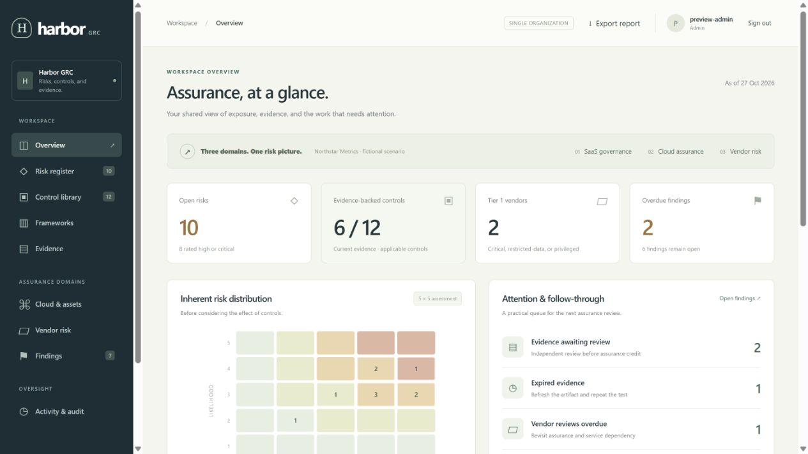
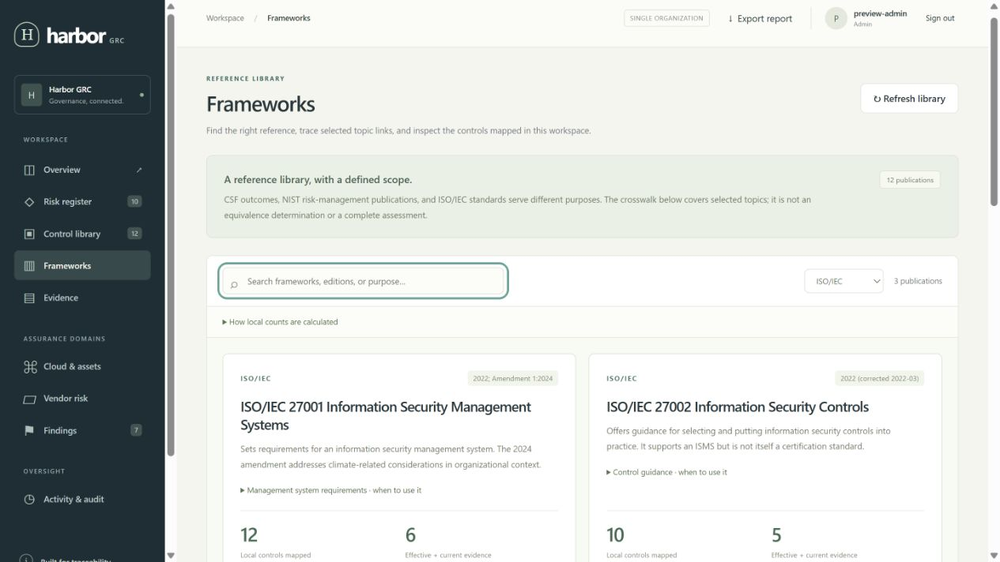
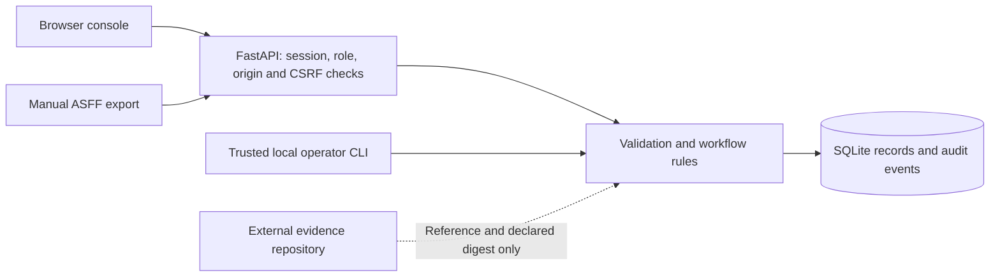

# Harbor GRC

Harbor GRC is a working application and a fictional assessment case study for
**SaaS governance, cloud assurance, and third-party risk management**. It brings
risks, controls, evidence, findings, assets, and suppliers into one workflow.

**Current status:** a tested portfolio project and a foundation for controlled
pilots. It still needs security and operational validation before workplace
production use.

[Objectives](#project-objectives) · [Capabilities](#what-it-can-do) ·
[Limitations](#what-it-cannot-do) · [Local setup](#run-it-locally) ·
[Verification](#what-has-been-verified) · [Documentation](#documentation-map)



## Why this project exists

A technical finding is only the beginning of a GRC decision. Someone still needs
to identify the affected service, explain the possible business loss, assign an
owner, agree on treatment, review evidence, and decide what risk remains.

Those steps are easy to lose when the risk register, cloud findings, supplier
questionnaires, and evidence records live in separate places. Harbor keeps their
relationships visible and makes the reasoning behind a decision easier to inspect.

The project uses **Northstar Metrics**, a fictional B2B SaaS company. Its scenario
gives you concrete work to assess without publishing an employer's policies,
customer records, cloud configuration, or audit evidence.

## Project objectives

The objective is to make a GRC decision traceable from an observation to an owned
action and a documented review.

The project was designed to:

1. **Connect technical and business views.** Keep a scanner observation separate
   from the business risk it informs, while linking the relevant asset and control.
2. **Make ownership and follow-through visible.** Record owners, treatment,
   remediation notes, due dates, and decisions.
3. **Support evidence-based review.** Check review identity, evidence dates, and
   control cadence before selected assurance decisions can proceed.
4. **Keep judgment explicit.** Require rationale for residual risk and acceptance,
   instead of lowering risk automatically when controls are linked.
5. **Reuse controls across selected references.** Explain how a local control
   relates to NIST/ISO topics without claiming that a mapping proves conformance.
6. **Provide a reproducible learning project.** Supply a runnable application,
   synthetic data, operating guidance, templates, and tests of failure cases.

A successful demonstration follows one finding through its risk, control, evidence,
and review; explains the remaining uncertainty; and shows why an unsupported
operation is rejected. It does not establish that a real organization's controls
are effective or that the organization has achieved certification.

## Who it is for

- **GRC learners and portfolio builders** who want to demonstrate a complete,
  explainable workflow rather than a collection of policy documents.
- **Analysts and engineers** exploring the relationship between business risk,
  technical observations, supplier decisions, and assurance evidence.
- **Small teams evaluating a pilot**, after reviewing the access model, deployment
  boundaries, and requirements of their own organization.

For a job interview, use the repo to show behavior you can reproduce and decisions
you can explain. Describe the parts you reviewed, changed, tested, or deployed;
the fictional scenario is not a claim of real client or audit experience.

## What it can do

| Area | Delivered behavior |
| --- | --- |
| Risk register | Record scenarios, owners, 1–5 likelihood/impact ratings, treatment, due dates, linked controls, residual rationale, and time-bounded acceptance. |
| Control library | Store control ownership, test procedures, cadence, implementation status, and explicit framework references. |
| Evidence register | Track a stable HTTPS reference, declared SHA-256, collection/expiry dates, submitter, reviewer, status, and review notes. |
| Findings | Link observations to risks, controls, assets, and suppliers; track severity, remediation, due dates, closure evidence, and accepted-risk references. |
| Vendor risk | Record the supplier's use, data sensitivity, access, criticality, questionnaire score, assurance notes, decision, and next review date. Derive a triage tier from exposure inputs. |
| Asset inventory | Record in-scope services/resources, provider labels, environment, external identifiers, classification, and criticality. |
| Cloud import | Import a bounded, manually supplied AWS Security Finding Format (ASFF) export; recognize repeat source observations and link an inventoried asset by its exact external identifier. |
| Framework library | Search 12 publication references and inspect 79 project-authored partial links across 12 starter control topics. |
| Dashboard | Show inherent risk distribution, evidence-backed control counts, overdue work, unreviewed residual ratings, and stale-evidence attention signals. |
| Audit and reporting | Record actors, actions, versions, and changed field names; verify a SHA-256 chain; export current registers, metrics, framework data, and an audit checkpoint as JSON. |
| Local operations | Create/reset/disable accounts, revoke sessions, generate a passphrase, create a consistent database backup, and verify the audit chain through the CLI. |

### Workflow rules the application actually enforces

- Evidence approval requires a different account from both the original creator
  and the current submitter. Changed artifact/scope fields cannot be approved in
  the same update; a separate eligible reviewer must approve the revised submission.
- Marking a control **effective** requires a documented test procedure and current
  approved evidence.
- Closing a **finding** requires remediation notes and current approved evidence.
  If the finding specifies a control, the evidence must belong to that control.
- Accepting a risk requires a different actor from its original creator, an
  acceptance treatment, a rationale, and a future expiry date.
- Residual ratings require both scores, a rationale, and a review date; the acting
  reviewer is recorded. The creator can enter a residual assessment.
- Stale record versions are rejected so an old browser form cannot silently
  overwrite a newer edit.
- Record changes and their audit events commit in the same database transaction.

These checks operate on account identities. They do not prove that two accounts
belong to independent people or that an approver has the right business authority.

### How cloud imports behave

The adapter processes **active, failed** ASFF observations. It requires a
timezone-aware source update time, rejects implausible future timestamps, and
limits a batch to **250 observations** within the **1 MiB request cap**.

An older or identical source timestamp is skipped. A newer failed observation
updates the existing finding and reopens it if it was closed or risk-accepted.
Assigned owners, remediation notes, links, and due dates are preserved for renewed
triage; the source title, description, severity, and timestamp are updated.
Passed observations do not automatically close findings or approve controls.

The default import due dates are example project policy. The owner still needs to
validate priority, scope, and the action plan. See the [API contract](docs/api.md)
for the supported subset and field requirements.

## What it cannot do

| Boundary | Practical implication |
| --- | --- |
| Live cloud scanning or remediation | There is no AWS/Azure/GCP scanner, credentialed collector, or configuration-changing integration. Asset provider labels are inventory data. |
| Artifact storage or verification | Evidence files stay elsewhere. Harbor does not download them, check their bytes against the declared digest, assess their contents, or operate their retention policy. |
| Automatic risk decisions | A control count, questionnaire score, or passed cloud check does not establish an acceptable residual risk. People still make and justify that decision. |
| Complete framework assessments | The reference pack omits most framework content. It does not produce a complete CSF Profile, ISO Statement of Applicability, RMF authorization, CMMC determination, or certification opinion. |
| Automatic sanitization or AI assessment | AI was used during authoring; the application has no runtime AI assessor or automatic redaction feature. Text you enter can still contain sensitive information. |
| Detailed approval authority | Record owner names are descriptive fields, not access permissions. The app does not enforce executive authority limits, department boundaries, or a delegation hierarchy. |
| Tenant or record isolation | Every authenticated account can read all registers in the organization. There is no multi-tenant boundary or per-record confidentiality model. |
| Immutable or complete historical storage | A database administrator can rewrite/truncate the audit chain. Events do not retain every previous field value, so they are not a complete revision-recovery system. |
| Enterprise identity and messaging | There is no built-in SSO, MFA, invitation email, password-reset email, notification service, or ticketing integration. |
| High availability or proven capacity | The current design is one application instance with SQLite on local disk. Failover, multi-instance operation, load limits, and service-level targets are not validated. |

Expired or rejected evidence removes current assurance coverage and raises
attention flags. It does **not** rewrite historical control/finding statuses.
Likewise, expired risk acceptance is flagged for review rather than renewed
automatically. The cloud recurrence rule above is a separate source-update event.

The application checks finding closure more strictly than risk closure. Closing
a risk currently requires a residual rationale; do not assume that every record
status change has an independent evidence-approval gate.

## An example from the case study

Suppose the export-storage finding needs attention:

1. The analyst records the observed condition and its affected asset.
2. The linked risk describes the possible customer consequence.
3. The control records the safeguard and the procedure used to test it.
4. The owner documents remediation and collects evidence in an approved repository.
5. Harbor records the evidence reference, digest, dates, and submission.
6. Another eligible account reviews the evidence and explains the result.
7. The finding can be closed when its closure checks pass. The risk owner then
   records a separate residual-risk judgment and any further treatment.

This demonstrates why a technical fix, control effectiveness, finding closure,
and risk acceptance are related but distinct decisions.

The [case study](docs/case-study.md) and [handbook](docs/handbook.md) walk through
the business scope and the work in more detail.

## Accounts and permissions

| Action | Administrator | Analyst | Auditor |
| --- | --- | --- | --- |
| Read registers, dashboard, frameworks, and audit activity | Yes | Yes | Yes |
| Export the JSON report | Yes | Yes | Yes |
| Create/update register records and import findings | Yes | Yes | No |
| Approve eligible evidence or accept another creator's risk | Yes | Yes | No |
| Manage accounts through the web interface | No | No | No |

Administrators and analysts currently have the same register-editing permissions.
Account creation, credential recovery, and disabling users are **trusted local
operator commands**. The CLI assumes administrative access to the host/database;
it is not a web account-management screen.

For an independent-review demonstration, create another account. Operating two
accounts yourself simulates the workflow; it does not establish real independence.

## Read the dashboard correctly

- The heatmap and high-risk count use **inherent** likelihood × impact. The scales
  are ordinal project choices, not calibrated probabilities or financial-loss models.
- The open-risk count includes all nonclosed risks, including accepted risks.
- Overall control coverage counts applicable controls whose stored status is
  effective **and** whose approved evidence is current. Not-applicable controls
  are excluded; an empty denominator has no coverage percentage.
- Evidence must be unexpired and within the control's test cadence, with valid
  collection dates, using UTC date boundaries.
- Framework counts describe distinct local controls with exact recognized
  references. Multiple links do not multiply a control's count.
- A reference-only publication can correctly show zero mapped controls. That
  means the pack supplies no selected mapping; it is not a failed assessment.

No dashboard value is a compliance percentage, certification score, or a substitute
for assessing the relevant scope and operating period.

## NIST and ISO reference library

| Reference in the catalog | How it is used here |
| --- | --- |
| NIST CSF 2.0 | Selected outcome references and a Current/Target Profile working template. |
| NIST SP 800-37 Rev. 2 — RMF | Lifecycle guidance; no government authorization workflow is implemented. |
| NIST SP 800-53 Rev. 5, Release 5.2.0 | Selected control identifiers for local-control mappings. |
| NIST SP 800-53A Rev. 5, Release 5.2.0 | Assessment-planning reference; published assessment objectives are not tracked as completed. |
| NIST SP 800-53B, Release 5.2.0 | Baseline/tailoring reference; no complete baseline is imported. |
| NIST SP 800-30 Rev. 1 | Risk-assessment guidance; Harbor's score bands remain project-defined. |
| NIST SP 800-161 Rev. 1, Update 1 | Supply-chain guidance for the supplier lifecycle. |
| NIST SP 800-171 Rev. 3 | CUI reference metadata; inclusion does not establish applicability or contractual compliance. |
| NIST SP 800-61 Rev. 3 | Incident-response and CSF Community Profile reference for the tabletop. |
| ISO/IEC 27001:2022, Amendment 1:2024 | Selected ISMS/Annex A identifiers and a Statement of Applicability working template. |
| ISO/IEC 27002:2022 | Selected control-guidance identifiers with original project descriptions. |
| ISO/IEC 27005:2022 | Information-security risk-management reference. |

The pack contains **79 partial associations across 12 starter topics**, with at
least one selected CSF identifier in each of the six Functions. This is breadth
across selected topics, not full Core or standard coverage.

Every association needs a scope and evidence judgment. The pack is project-authored,
not an official NIST/ISO equivalence determination. ISO standards text and a
complete Annex A inventory are not bundled.

Use the [framework guide](docs/frameworks.md), [crosswalk](docs/framework-crosswalk.md),
[CSF profile](templates/csf-organizational-profile.md),
[ISO applicability template](templates/iso-statement-of-applicability.md), and
[assessment plan](templates/framework-assessment-plan.md). Editions, checked dates,
and official source links are in the [source register](docs/sources.md).



## What comes with the repository

| Deliverable | Contents |
| --- | --- |
| Runnable application | Authenticated browser console, JSON API, SQLite storage, and operator CLI. |
| Fictional case study | Northstar Metrics: 10 risks, 12 controls, 5 vendors, 8 assets, 8 evidence records, and 7 findings. |
| Reference pack | Versioned publication metadata and the partial starter mappings. |
| Operating handbook | Governance, risk methods, cloud tests, vendor reviews, assurance, incident exercise, and rollout plan. |
| Reusable templates | Risk decisions, access reviews, vendor assessments, control tests, policy exceptions, management reviews, and framework assessment work. |
| Engineering material | Source, tests, locked dependencies, CI, packaging, Docker/Compose templates, architecture and recovery notes. |

The sample deliberately includes overdue work and evidence gaps. Its approved
evidence, hashes, suppliers, and outcomes are fictional; they are not artifacts
collected from a real organization.

## How it is built

| Component | Technology / role |
| --- | --- |
| Application | Python 3.11+, FastAPI, Uvicorn |
| Validation | Pydantic models plus domain/workflow checks |
| Storage | SQLite on local disk; atomic record/audit transactions |
| Browser console | HTML, CSS, and JavaScript served by the application |
| Tests and checks | pytest, Ruff, package build, runtime dependency advisory scan |
| Distribution | Python package, source repository, Docker/Compose deployment templates |

Normal local use needs no Node build, cloud credentials, or AI API key.



Read the [architecture and threat model](docs/architecture.md) and
[design decisions](docs/decisions.md) for the implementation choices and their costs.

## Run it locally

Start from the repository folder. If you do not already have a copy:

```sh
git clone https://github.com/aounali720/harbor-grc.git
cd harbor-grc
```

Python 3.11 or later is required; Python 3.11 and 3.12 are covered by the recorded
CI matrix. Use the virtual environment's Python for every command below.

### Windows PowerShell

```powershell
python -m venv .venv
.\.venv\Scripts\python.exe -m pip install -r requirements.lock
.\.venv\Scripts\python.exe -m harbor_grc init --admin admin --generate-password
```

The initialization command creates `admin` and prints a random passphrase locally.
Copy only the value after `Generated passphrase:` into your password manager.

To load the fictional case study and start the server:

```powershell
.\.venv\Scripts\python.exe -m harbor_grc seed-demo
.\.venv\Scripts\python.exe -m harbor_grc serve
```

Open **[http://127.0.0.1:8000](http://127.0.0.1:8000)** and sign in with `admin`
and the generated passphrase. There is no shared default password. Keep the
terminal running and press **Ctrl+C** to stop. On later visits, run only `serve`.

### macOS / Linux

```sh
python3 -m venv .venv
.venv/bin/python -m pip install -r requirements.lock
.venv/bin/python -m harbor_grc init --admin admin --generate-password
.venv/bin/python -m harbor_grc seed-demo
.venv/bin/python -m harbor_grc serve
```

Skip `seed-demo` for an empty workspace. It requires an empty records database
and is disabled in production. You can omit `--generate-password` to choose your
own 14–128 character passphrase; typing stays hidden.

### Account recovery and a second reviewer

Run from the project folder, targeting the same database as the server:

```powershell
.\.venv\Scripts\python.exe -m harbor_grc reset-user admin --role admin --generate-password
.\.venv\Scripts\python.exe -m harbor_grc create-user reviewer --role analyst --generate-password
.\.venv\Scripts\python.exe -m harbor_grc create-user auditor --role auditor --generate-password
```

Each command prints a separate generated passphrase. A reset revokes that user's
sessions and clears their username failure window; shared IP throttling remains.
Do not run `init` again to recover an existing account.

## Configuration and local troubleshooting

The app reads process environment variables; it does not load `.env` automatically.

| Variable | Default | Purpose |
| --- | --- | --- |
| `GRC_ENV` | `local` | Local or production mode. |
| `GRC_DATABASE` | `data/harbor.db` | Database file used by both the server and CLI commands. |
| `GRC_ORIGIN` | `http://127.0.0.1:8000` | Exact browser origin, without a path or trailing slash. |

Local mode is restricted to loopback. Production requires an HTTPS origin and a
properly configured proxy/deployment; setting the variable alone does not complete
that work. If you change the port or hostname, update the origin to match.

| Symptom | What to check |
| --- | --- |
| The page cannot connect | The `serve` process must still be running. Open the exact HTTP address configured for it. |
| `admin` does not work on a fresh database | Finish `init` successfully; no built-in account is created merely by starting the server. |
| Passphrase entry keeps failing | Use `--generate-password` to bypass hidden input, or enter matching 14–128 character values. |
| “Already initialized” | Recover with `reset-user`; do not initialize that database again. |
| A reset seems to affect the wrong account | Check the username and `GRC_DATABASE`. Separate workspaces have separate accounts. |
| “Too many attempts” | The failure window is 15 minutes. A shared IP limit can remain after a password reset. |
| Origin/host rejection | Use the configured hostname, scheme and port consistently. |

The [deployment guide](docs/deployment.md) has the full recovery, proxy, storage,
and account-lifecycle procedures.

## Data, exports, and backups

Evidence artifacts remain in your organization's approved repository. Harbor
stores their metadata, while SQLite holds application records, account hashes,
sessions, and audit events.

Useful operator commands:

```powershell
.\.venv\Scripts\python.exe -m harbor_grc export reports/assessment.json
.\.venv\Scripts\python.exe -m harbor_grc backup backups/harbor-backup.db
.\.venv\Scripts\python.exe -m harbor_grc verify-audit
```

Choose a new filename for each export/backup; existing destinations are not
overwritten. Reports omit user/session tables but may contain sensitive business
metadata. Backups include password hashes and session data and need protection.
Keep trusted audit checkpoints under separate administrative control.

Do not commit real databases, exports, credentials, signed evidence URLs, or
employer material. The ignore rules exclude common local state; they do not
automatically detect every sensitive fact in a text file or screenshot.

## What has been verified

The recorded local suite passed **113 tests**. The first public
[GitHub Validate run](https://github.com/aounali720/harbor-grc/actions/runs/40516543010)
also passed all five jobs for the documented application/source commit:

| Environment / job | Recorded result |
| --- | --- |
| Windows, Python 3.11 | Dependency installation, Ruff, pytest and package build passed. |
| Windows, Python 3.12 | Dependency installation, Ruff, pytest and package build passed. |
| Ubuntu, Python 3.11 | Dependency installation, Ruff, pytest and package build passed. |
| Ubuntu, Python 3.12 | Dependency installation, Ruff, pytest and package build passed. |
| Runtime dependency advisory scan | Passed for the pinned runtime set at that run. |

Tests cover approval boundaries, evidence freshness, reference integrity,
concurrency versions, imports, rollback, sessions, CSRF/roles, account recovery,
backup behavior, and audit verification. See [verification notes](docs/verification.md)
for the tested source, dates, environment, and retained warning.

A passing test or advisory scan is bounded evidence. It does not establish
independent security assurance, real control effectiveness, or safety for every
deployment.

## Before workplace production use

The remaining work depends on the intended environment. At a minimum, the owner
needs to accept and validate:

- The data scope, authorized readers, reviewer/approver authority, and retention.
- An appropriate identity/MFA boundary and independent security assessment.
- The container/host, HTTPS proxy, secrets handling, and client-IP throttling.
- Monitoring, alerts, backup protection, actual restoration, and incident support.
- Capacity, concurrent-use behavior, availability targets, and recovery objectives.
- Applicable standards/obligations and the adequacy of real evidence.

Docker and Compose files are supplied as deployment templates. Container operation,
a real HTTPS deployment, load/soak testing, and organization-specific recovery
objectives have not yet been validated. The recorded CI checks cover the Python
application and package. Use the [deployment checklist](docs/deployment.md) and
[roadmap](ROADMAP.md).

## Documentation map

| Topic | Guide |
| --- | --- |
| Business service, assumptions and boundary | [Northstar case study](docs/case-study.md) |
| End-to-end work from finding to decision | [Handbook](docs/handbook.md) |
| Risk scales, treatment and acceptance | [Risk methodology](docs/risk-methodology.md) |
| Ownership, policies and review cadence | [Governance](docs/governance.md) |
| Cloud checks and supplier lifecycle | [Cloud assurance](docs/cloud-assurance.md), [vendor risk](docs/vendor-risk.md) |
| Sampling, evidence review and retesting | [Control testing](docs/control-testing.md) |
| Incident exercise and adoption plan | [Tabletop](docs/incident-tabletop.md), [implementation plan](docs/implementation-plan.md) |
| API, trust boundaries and tradeoffs | [API](docs/api.md), [architecture](docs/architecture.md), [design decisions](docs/decisions.md) |
| Framework use and source editions | [Framework guide](docs/frameworks.md), [sources](docs/sources.md) |
| Portfolio demonstration and provenance | [Portfolio guide](docs/portfolio.md) |
| Working assessment forms | [Templates](templates/) |

## Development and contributions

```sh
python -m pip install -r requirements-dev.lock
python -m pytest
python -m ruff check .
python -m build --no-isolation
```

Keep changes tied to a real workflow and a testable failure case. A new database
schema needs an explicit migration, backup/restore and rollback plan. Dependency
versions are pinned, but the locks are not cryptographic package-hash locks.
See [CONTRIBUTING.md](CONTRIBUTING.md) for the working conventions.

## Data provenance, security and license

The company, supplier records, assessments, evidence references, hashes, and
outcomes in the demonstration are synthetic. The code and documentation were
developed with AI assistance. That assistance is not an independent review,
automatic sanitization guarantee, or a claim of real client experience.

Framework identifiers and source links are reference material; the original
project descriptions do not replace licensed standards or professional assessment.

Use the private reporting route in [SECURITY.md](SECURITY.md) for security concerns.
The project is [MIT licensed](LICENSE).
