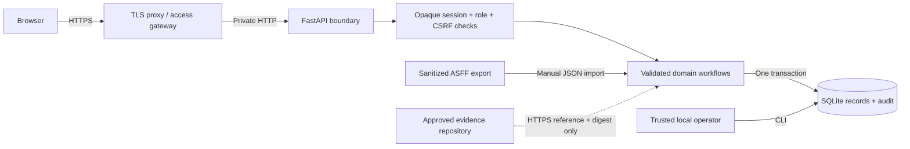

# Architecture and threat model

Harbor is a single-organization application. Its intended initial deployment is one
small team, one application worker, and one SQLite database on a local encrypted
disk. There is no tenant identifier or row-level permission partition: every
authenticated account can read every register. Treat membership as a confidentiality
decision.

## Request and data flow

The server never follows an evidence URL or calls AWS. The console contains no
third-party script, font, analytics, or CDN request. FastAPI serves static assets
from the package. The API returns JSON schemas so forms use the same constraints
as the server; the server remains authoritative.

## Components

| Module | Responsibility |
|---|---|
| config.py | Validate local/production origin and database settings |
| db.py | Schema version, connection settings, transaction boundaries |
| auth.py | Password hashing, session issue/expiry/revocation, login throttles |
| app.py | HTTP limits, origin/CSRF/role checks, security headers, routes |
| schemas.py | Field types, bounds, enums and cross-field validation |
| domain.py | References, approval gates, concurrency, metrics, audit chain |
| cloud.py | Bounded offline ASFF normalization and source-key deduplication |
| frameworks.py + data/*.json | Versioned standards references, partial starter mappings and exact-reference local counts |
| seed.py | Linked fictional demonstration records |
| __main__.py | Operator accounts, backup, export, chain verification, server |

## Storage and consistency

Version 1 stores six record types in a JSON-backed `records` table, with common
ID, kind, version, creator, and timestamps. Pydantic validates payloads and the
domain layer validates references before SQL updates. JSON is intentional here:
one compact domain boundary is easier to inspect than six partial CRUD paths.
It trades SQL-enforced relationship constraints and ad hoc relational queries
for simpler application code. There is no delete API.

Each write starts `BEGIN IMMEDIATE`; the record update and its audit event commit
together. Optimistic versions reject a stale edit with HTTP 409. Read requests
also take a short write transaction to refresh the session's idle timestamp.
That is conservative and limits throughput. SQLite WAL and a ten-second busy
timeout handle short contention; they are not an availability strategy.

All dates and reporting boundaries use UTC. Date-only due dates are overdue after
the UTC date ends. Evidence freshness requires both its stated expiry and the
linked control's test cadence to remain current. A stored effective status can
become stale; the dashboard reports that distinction without rewriting the
historical decision.

## Permissions

| Action | Admin | Analyst | Auditor | Local operator |
|---|---|---|---|---|
| Read all records / audit / export | Yes | Yes | Yes | CLI export |
| Create and edit registers | Yes | Yes | No | Programmatic administrative access |
| Approve own created/submitted evidence | No | No | No | Not an application workflow |
| Approve evidence submitted by another person | Yes | Yes | No | Not an application workflow |
| Accept a risk one created | No | No | No | Not an application workflow |
| Manage accounts / reset roles / revoke sessions | No web endpoint | No | No | Yes |

Local commands assume trusted host access. They record the generic actor
`local-operator`; use host-level logs to attribute the individual operator.
An analyst can accept another person's risk without an executive-approval
authority matrix. The handbook requires business authorization; this release
does not encode that hierarchy.

## Security controls and limits

| Threat | Implemented control | Remaining boundary |
|---|---|---|
| Offline password cracking | Random salt; scrypt N=131072, r=8, p=1 | Host encryption and account lifecycle still matter |
| Session theft/fixation | Random 256-bit cookie; only digest stored; rotation on login | No MFA/SSO; compromise of browser or host is outside scope |
| CSRF and login CSRF | Exact origin on every mutation and session-bound CSRF on register writes | Non-browser clients must send Origin and CSRF explicitly |
| Cross-site scripting | DOM textContent; no raw record HTML; CSP; no external scripts | Browser extensions and compromised static files remain privileged |
| Excessive JSON | 1 MiB request cap; ASFF limit 250; field/list limits | Proxy request timeout/concurrency and host quotas are necessary |
| Brute force | Persistent 15-minute per-principal and direct-IP failure windows | Proxy must rate-limit real client IP; identity lockout can be abused for denial of service |
| Lost edits | Expected record version in conditional SQL update | User must resolve stale edits after reload |
| Record/audit divergence | Atomic transaction | DB administrator can bypass the application |
| Audit tampering | SHA-256 chain with exportable head/count | Full rewrite/truncation needs external trusted checkpoint to detect |
| Evidence URL SSRF | No server-side URL fetch | A reference can still identify a malicious site to a human |
| Cloud import over-trust | Failed active observations only; no automatic closure/approval | Source authenticity and export completeness are manual checks |

Passwords and session tokens never enter a report. Error validation returns
field names and messages without echoing submitted input. Audit events retain
actor/action/record version/changed field names, not full previous values.
This supports a lightweight activity trail, not complete forensic version recovery.

## Trust boundaries and failure handling

A hostile unauthenticated client must not read any register. An auditor must not
write one. An analyst is trusted with all organizational metadata but must pass
workflow gates. A malicious analyst can still enter false descriptions and digests;
independence is a process control and does not prove truth.

DB locks/errors return a generic retryable 503. Unknown records return 404,
schema violations 422, workflow failures 400, stale versions 409, and authorization
failures 401/403. Live health is process health. Ready health checks a metadata query;
neither is proof of audit integrity, backup health, or valid user setup.

Schema version 1 has no upgrade path because this is the first release. Startup
rejects unknown schema versions. Any future schema change must ship a migration,
old-database tests, and rollback instructions. Back up before an upgrade and restore
the entire compatible application/database pair when rolling back.

See [OWASP password guidance](https://cheatsheetseries.owasp.org/cheatsheets/Password_Storage_Cheat_Sheet.html)
for the hashing choice and
[FastAPI HTTPS guidance](https://fastapi.tiangolo.com/deployment/https/) for TLS termination.

## Framework pack boundary

Framework catalogs are local package resources, not remotely fetched configuration.
They contain original summaries, identifiers, official source links, applicability
notes and a check date. They do not contain ISO standards text or a full standards
control inventory. The library treats a project crosswalk as a suggestion for
scope review, not an assurance judgment.

The domain schema remains version 1: framework_refs was already a list on controls.
New demo records receive selected additional references; existing real records
are not changed on startup. The explicit apply-demo-framework-mappings operator
command requires the demo tag and local mode. Each changed record uses the usual
version and audit path. No new write-capable web endpoint is introduced.
