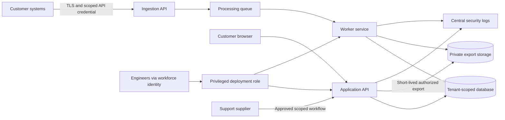

# Case study: Northstar Metrics

Northstar Metrics is a fictional B2B SaaS company providing subscription analytics. This scenario demonstrates judgment and traceability. Its staff counts, objectives, vendors, findings, and decisions are invented; no customer environment was assessed.

## Business context

The company has 45 staff, including 14 engineers and a two-person infrastructure team. It serves 60 fictional business customers. Customers send event records and account metadata to a tenant-aware ingestion API, then use dashboards and scheduled exports. Revenue depends on reliable access and confidence that one tenant cannot access another tenant's data.

The service does not intentionally process payment card numbers, health records, passwords from customer systems, or government identifiers. A prohibited-data statement does not prove absence: ingestion validation, customer guidance, and periodic field reviews are needed. The sample contains no real personal data.

The project assumes an AWS organization with separate production, nonproduction, and logging accounts. Production runs in one primary region with backups in another. This is a case-study architecture; Harbor is a separate GRC application and does not create or validate the AWS estate.

## Boundary

| In scope | Why it matters | Accountable function |
| --- | --- | --- |
| Customer API, workers, dashboards, exports | Tenant isolation and availability | Engineering |
| Production AWS identities, storage, databases, networking, logs | Customer data and privileged changes | Platform |
| Source repositories, build pipeline, deployment permissions | Software integrity and supply chain | Engineering |
| Workforce identity, support access, administrative endpoints | Routes into customer-facing systems | IT / Security |
| Hosting, identity, support, messaging, build suppliers | External dependencies and data access | Business service owner |
| Joiner/mover/leaver, incident response, vendor onboarding, recovery | Operating processes | Respective process owner |

Personal devices with no company access and customer-managed source systems are outside this assessment boundary. Their interfaces remain relevant: customers configure their API credentials and validate submitted data. Marketing systems remain outside until a data flow or privileged integration brings them into scope.

## Data flow and trust boundaries

Each arrow is a review question. Where is tenant context established? Can a worker act across tenants? What happens when a supplier account is disabled? Does an export link outlive authorization? The diagram supports discussion; it does not prove these boundaries are enforced.

## Data classes and handling

| Class | Scenario example | Handling expectation |
| --- | --- | --- |
| Public | Published product documentation | Approved for public distribution |
| Internal | Procedures and asset inventory | Company access; review before sharing |
| Confidential | Customer account metadata and security findings | Need-to-know; protected storage and transport |
| Restricted | Production credentials and evidence containing sensitive customer data | Approved secret/evidence systems; exclude from GitHub |

A 30-day application log window and 12-month security evidence target are planning assumptions, not legal requirements. Reconcile retention with contracts, deletion obligations, investigations, and applicable law before adoption.

## Business impact assumptions

The service owner proposes a four-hour recovery time objective and one-hour recovery point objective for core analytics. These are unvalidated targets. Restore testing must measure data loss, application readiness, dependencies, and user access before management relies on them. “Backup enabled” establishes neither objective.

Initial priorities are preventing cross-tenant disclosure, reducing privileged account compromise, and making supplier dependencies recoverable. Engineering capacity is limited. The program therefore requires dated decisions with owners rather than an undifferentiated backlog.

## Demonstration threads

**SaaS governance:** an overdue access review leaves a departed contractor with support privileges. Trace the access population, revocation evidence, independent retest, and residual risk.

**Cloud assurance:** an export bucket has a fictional exposure finding. Trace the observation, asset scope, preventive control, configuration change, and post-change test.

**Vendor risk:** a support supplier requests a new data integration. Compare it with the approved data flow, reassess tier, request relevant contractual/security review, and document the decision.

These threads apply even if seed data changes. Locate records by title instead of treating generated sample IDs as permanent presentation references.
